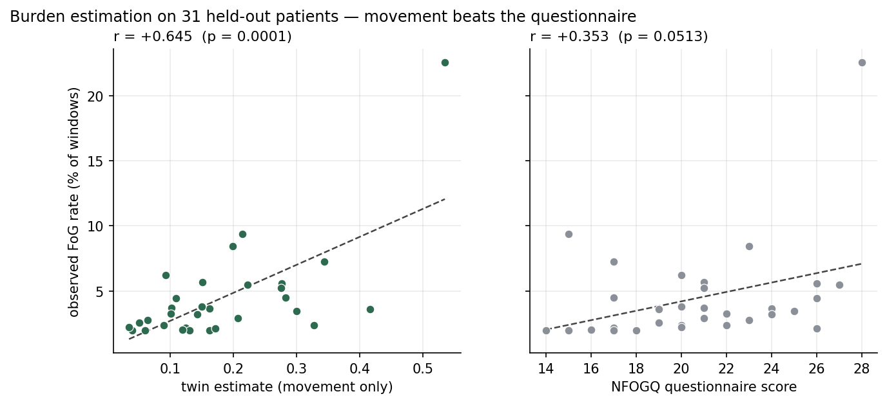

# Parkinson's Freezing-of-Gait Digital Twin

**Digital Twin Challenge 2026 — Happiest Health**

| | |
|---|---|
| **Team** | Team Asha |
| **Institution** | Sir M. Visvesvaraya Institute of Technology (Sir MVIT), Bengaluru |
| **Team leader** | Ashmit Rai |
| **Condition** | Parkinson's disease — freezing of gait (FoG) |
| **Licence** | MIT (see `LICENSE`) |
| **Video demo** | [LINK — add before submission] |

---

## What this is

A movement-only digital twin that estimates a Parkinson's patient's current
freezing-of-gait (FoG) burden from movement unseen during training for that
patient. On held-out patients, Spearman ρ = 0.51 (p = 0.003) and Pearson
r = 0.65 (p = 0.0001); standard NFOGQ does not reach significance in the same
cohort (r = 0.35, p = 0.051). The twin retains independent signal after
controlling for NFOGQ (r = 0.61, p = 0.00035) and activity level (r = 0.66,
p = 0.00008). Final values are reported in `RESULTS.md`.

The twin fuses two data streams, as the challenge requires:

- **Static / historical** — demographics, years since diagnosis, UPDRS-III
  (on and off medication), NFOGQ, medication state at recording time.
- **Dynamic / real-time** — continuous tri-axial lower-back accelerometry,
  including approximately one week of uninterrupted 24/7 home recording per
  patient.

The burden estimator is movement-only. The submitted model remains **Model C**:
a fusion of the patient's movement history, static clinical state, and
continuous accelerometry. The acute episode-warning task remains a weak
secondary result; burden estimation is the primary validated output.



### Burden-estimation caveats

- This is concurrent estimation, not prospective forecasting: the twin
  estimates how much a patient is freezing now from movement it has not seen
  from that patient. It does not predict future burden.
- The result is correlational, from one cohort of 31 patients, with no external
  validation.
- Lead with Spearman. Pearson is leverage-sensitive: one high-burden patient
  drives part of it. Excluding that patient gives r = 0.387 (p = 0.035); across
  all single-patient deletions r spans 0.39–0.71 and remains significant.

## Why this is a twin and not a classifier

This is the question the design is built to answer, so we answer it first.

A conventional FoG model maps an accelerometer window to a label. It treats
every patient as the same patient.

Our model conditions each prediction on **that individual's own motor
baseline**, derived from their week of unlabelled home recording, so what the
model sees is not raw movement but *deviation from this person's normal*:

```
Deviation_i(t) = ObservedState_i(t) - PersonalBaseline_i
```

The baseline comes from the `daily` cohort, which carries **no FoG labels at
all**. Personalisation therefore cannot leak the target — the twin's patient
representation is learned from data that contains no answers.

We report an ablation (raw encoder → + deviation → + clinical state) so the
contribution of the twin's state representation is measured, not asserted.

## Secondary episode-level forecasting

At time *t*, using only information available at *t*, estimate the probability
of FoG onset within a horizon *h*.

We report performance **as a function of *h*** across 0.5–5 s. This secondary
analysis remains weak, at roughly 2–3× chance; four personalisation mechanisms
were tested and all four were null. Full values are in `RESULTS.md`.

Full specification, including leakage rules: `docs/03_data_and_target.md`.

## What the twin does NOT claim

Stated up front rather than buried. The twin does not claim:

- to reproduce the patient's whole physiology;
- that a predicted episode will certainly occur;
- that it forecasts future burden;
- that it prevents falls;
- that the warning horizon has been shown to improve clinical outcomes;
- that any cross-cohort patient identities are linked;
- that synthetic or derived components constitute clinical evidence.

Extended version: `docs/02_twin_spec.md`, §7.

## Documentation

| Document | Contents |
|---|---|
| `docs/01_problem.md` | Clinical problem, why FoG, relevance to India |
| `docs/02_twin_spec.md` | Patient-state model, state layers, boundaries |
| `docs/03_data_and_target.md` | Dataset roles, linkage, target, leakage rules |
| `docs/00_workflow.md` | **Start here** — decisions, pipeline, results, remaining work |
| `docs/04_evidence_matrix.md` | Every claim with its evidence class and source |

**Start with `docs/04_evidence_matrix.md`.** Every substantive claim in this
repository is labelled VERIFIED / INFERRED / ASSUMED / SYNTHETIC, with its
source. Nothing is stated more strongly than its evidence supports.

## Technical stack

- Python, PyTorch
- 1D temporal convolutional encoder over raw tri-axial accelerometry
- Fusion head over three branches: window encoder, personal-baseline deviation
  vector, static clinical state
- Evaluation: subject-level `GroupKFold` — no subject appears in more than one
  fold
- Dashboard: single self-contained HTML page (`dashboard/index.html`), reading `dashboard/twin_data.json`

## Data

All data are open-source and used under their published terms. No real patient
data were collected by this team. Dataset provenance and cohort structure are
documented in `docs/03_data_and_target.md`.

## Repository layout

```
.
├── README.md
├── LICENSE
├── docs/
│   ├── 01_problem.md
│   ├── 02_twin_spec.md
│   ├── 03_data_and_target.md
│   ├── 04_evidence_matrix.md
│   └── architecture.pdf
├── presentation.pdf
└── notebooks/
```

## Reproducing

The pipeline runs on Kaggle, where the dataset is hosted.

1. `notebooks/02_preprocessing.ipynb` — harmonisation, event-alignment audit,
   window generation, daily-baseline profiling, deviation features.
   Run as **Save & Run All (Commit)**, GPU T4. ~1.5 h.
2. `notebooks/04_model_seeds.ipynb` — multi-seed ablation. Add the output of
   step 1 as an input dataset. ~45 min.

Outputs land in `/kaggle/working` and are bundled as `asha_outputs.zip`.

## Dashboard build

The committed `dashboard/index.html` is self-contained and works when opened
directly with `file://`; evaluators do not need a server or build step. To
regenerate it after changing the canonical data:

1. `python3 scripts/make_synthetic_patient.py`
2. `python3 scripts/build_dashboard.py`

The build embeds `dashboard/twin_data.json` and the clearly labelled synthetic
demo patient. The synthetic record is asserted to be absent from all reported
cohort statistics.
